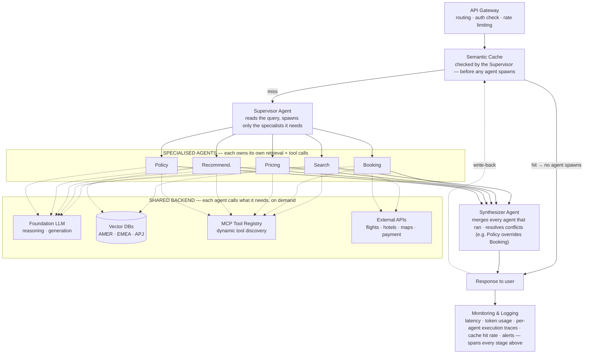

# Worked Example — The Travel Agent

> **Level** 🟢 Foundations · **Module** 02 · **Doc** 4 of 5 · **Time** ~30 min
> **Prerequisites:** The 12-Part Framework, The 15 Principles
> **Source material:** System Design Overview

## Why this matters

Principles stay abstract until you watch them repair a real diagram, so that is what this document does. We take a sample design for a travel assistant built from AI agents, list five structural faults a careful review found, and redraw it. Keep the habit of *spotting* those faults; the fixed diagram matters less. Most first-pass multi-agent sketches repeat the same five, including the ones you will draw under time pressure.

The brief: an AI travel assistant serving customers in three regions (AMER, EMEA, APJ), where one specialist agent each handles policy, pricing, search, booking and recommendation.

## The original, and what was wrong with it

The first draft was a rigid pipeline. Five agents fanned out, and then *all* of their work squeezed through a single shared cache, a single retrieval stage, a single LLM step and a single tool-calling stage, one after another. It needed five fixes.

### 1 · Rate limiting belongs inside the API gateway

In the draft, Rate Limiter hung off the load balancer as its own box, side by side with the gateway. No line left it, so anything sent there went nowhere. Rate limiting is not a route. It is *a rule the gateway applies to every request*. A separate box implies a component, and rate limiting is a behaviour.

### 2 · The semantic cache is checked before any agent spawns

The draft put the cache *behind* the five agents, so it was only consulted after they had all run. If a cache exists to cut LLM latency and cost, it must come before the costly work. Now the supervisor looks in the cache before doing anything else. On a hit, the answer goes back and no agent is spawned at all. In 12-part framework terms this is short-circuiting, and the placement decides whether the cache saves money or nothing.

### 3 · Retrieval is owned by each agent, not a shared stage

A single compulsory retrieval box after all five agents made every agent query the vector DB, whether it needed to or not. Search and Recommendation do draw on regional travel content. Booking and Policy rarely do. In the fix, each agent calls retrieval itself, within its own loop, and only when its task calls for it.

### 4 · Tool calling, MCP and external APIs sit alongside the agents

In the draft, all five agents passed in sequence through a shared LLM box, a shared tool-calling box and a shared MCP registry. That reads as though the request gets a single turn in total. Booking actually calls the Flight and Payment MCP servers *during its own work*; it cannot wait until four other agents finish. The redraw makes the LLM, the MCP registry, the external APIs and the vector DBs a shared backend that each agent calls on demand.

### 5 · A synthesiser agent replaces the missing aggregation step

Nothing in the draft explained how five parallel results became a single reply. The flow simply carried on as one line, as though merging took care of itself. It does not. In the fix, a named Synthesiser Agent gathers the output of each agent that ran and settles any clash between them before the user sees anything. A Policy ruling that overrides a Booking choice is the classic example.

## The corrected architecture

On a cache hit, the user gets a reply and no agent starts. If it misses, the supervisor spawns just the agents this query calls for, and each one pulls from the shared backend only what its own task needs. The synthesiser merges their results into one answer, which is also saved to the cache.

## Components

| Component | Purpose |
|---|---|
| Client | Web and mobile app for searching, booking and managing trips |
| Authentication | Runs first: SSO through OpenID Connect (an identity layer built on OAuth 2.0), issuing JWTs as tokens |
| Load balancer | Shares traffic across API instances |
| **API gateway** | A *single* policy layer that routes, validates and throttles requests |
| **Supervisor agent** | Reads the query and looks in the cache first; picks specialists to start only after a miss |
| **Semantic cache** | Checked straight away; on a hit, no agent is spawned |
| **Specialised agents** | Each pulls the domain context and tools its task needs; Booking reaches the payment gateway directly |
| Regional vector DBs | Shared retrieval that an agent queries when it chooses, not a stage on every request's path |
| MCP tool registry | Finds tools at run time; any agent that needs it can call it |
| External APIs | Flights, hotels, maps and payment, reached through MCP servers |
| **Synthesiser agent** | Combines outputs, settles conflicts and returns one coherent reply |
| Monitoring & logging | Tracks latency, tokens, failures and a trace for each agent |

## Data flow, in order

1. A user sends a request.
2. Authentication confirms who they are, the load balancer picks an instance, and the gateway enforces rate limits before passing the request to the supervisor.
3. **First**, the supervisor looks up the semantic cache.
4. A hit returns at once, and no agent is spawned.
5. On a miss, the supervisor starts just the agents this query calls for.
6. Inside its own loop, an agent that needs context makes a tool call to the matching regional vector DB.
7. In that same loop, it calls external APIs via the MCP registry.
8. The synthesiser gathers the outputs, settles conflicts and writes one grounded reply.
9. The user receives the reply, and a copy goes into the cache.
10. Across the whole request, monitoring captures latency, token counts and a trace per agent.

## Non-functional requirements

| Requirement | Solution |
|---|---|
| Scalability | Scale out horizontally, autoscale, balance load |
| Reliability | Deploy in several regions; retry; fail over |
| Availability | Regions run active-active |
| Performance | Semantic cache placed *ahead of* the fan-out; Redis; CDN; tuned vector search |
| Security | OAuth, JWT, encryption, RBAC, managed secrets |
| Cost | A cache-first design where the cache really does gate spawning; small models for easy tasks; routing by region |
| Observability | Metrics, logs, a distributed trace per agent, dashboards, alerts |
| Maintainability | Modular agents that each own their tools; CI/CD; infrastructure as code |

## Trade-offs worth naming out loud

**Shared retrieval service vs per-agent RAG.** One shared retrieval layer gives you a single place to enforce data residency and guardrails, but every agent then depends on that one service. Per-agent retrieval matches how frameworks such as LangGraph and CrewAI wire tools to each agent, yet without governance you end up running several copies of the embedding stack. You can defend either choice. What is actually wrong is placing RAG beside the agents *as if it were one of them*; it is infrastructure, or a tool.

**Single agent vs multi-agent.** Every extra agent adds coordination and a synthesis step you must pay for. Pay it when sub-tasks differ in their tools or guardrails, or must scale on their own. Booking and Policy plainly do. Module 07 sets out the full rule for deciding.

**Semantic cache vs traditional cache.** A traditional cache only hits on an exact repeat. A semantic cache also matches near-duplicates, so it can skip the entire fan-out rather than save a single call downstream.

**Global vs regional vector DBs.** Stores per region make data-residency rules easier to meet and bring latency down. One global store is simpler to run and keeps regions consistent with each other.

## A mental model: the international airport

| Airport | System |
|---|---|
| Travellers | Users |
| Terminal entrance | Authentication |
| Security screening and bag scan in a single lane, not two | Rate limiting as part of the API gateway |
| Help desk that checks "did someone already answer this?" | Semantic cache, consulted before staff are dispatched |
| Control tower | Supervisor agent |
| Airline crews, each with its own manuals and radios | Specialised agents, each with its own retrieval and tools |
| Reference binders kept at each desk | Vector databases, consulted by any desk that needs one |
| Ground handlers, caterers and fuel trucks | External APIs |
| Dispatcher who writes one departure report | Synthesiser agent |
| CCTV and the operations room | Monitoring and observability |

## Interview lens

Each of the five fixes turns into a question you can put to any multi-agent diagram, your own included:

1. Is each box a real component, or a policy that should live inside another one?
2. Does the cache come *ahead of* the costly work it is meant to avoid?
3. Are agents made to retrieve when they have no need to?
4. Does every agent loop and call tools by itself, or must the whole request squeeze through a single shared stage?
5. Where do the parallel results meet, and who settles disagreements between them?

## Checkpoint

- List the five structural fixes. Which principle from the last document does each one apply?
- Why does the position of a semantic cache decide whether it saves anything?
- When teams argue shared versus per-agent RAG, what mistake actually matters?
- Which job of the synthesiser is hidden when a diagram just "carries on as one line"?
- Redraw the corrected architecture without looking.

## Level calibration

On the travel assistant, the levels split on whether the candidate only fixes the diagram's flow or also owns how the fixed system runs across regions and teams.

| Level | Sounds like | Missing |
|---|---|---|
| Senior | "Rate limiting lives inside the gateway. The supervisor checks the semantic cache before it spawns anything, and each agent calls retrieval and MCP tools inside its own loop. A synthesiser merges whatever ran and lets Policy override Booking." | Which queries may be served from the cache at all, and what the synthesiser does when one spawned agent fails or times out. |
| Staff | "Shared retrieval versus per-agent RAG is a deliberate choice: shared for residency and guardrails, or per-agent with governance so embedding infrastructure isn't duplicated. I'd run it like a platform, with per-agent traces, cache hit rate and token usage on dashboards, smaller models for simple agents, and retries and failover per region." | Who owns each regional vector DB and the MCP tool registry, and the rule for when a new agent earns its coordination overhead. |
| Principal | "AMER, EMEA and APJ stores buy residency and latency, and one global store buys simpler operations, so I'd make that call region by region on an active-active footprint. Then I'd turn the five fixes into a review standard every team's multi-agent diagram has to pass." | Each region's residency rules and the real traffic mix, which only the customer can supply. Until then, [cache hit-rate target] and [p95 target] stay open. |

**Next →** The 60-Minute Whiteboard Method

## Sources (checked 27 Sep 2026)

- [OpenID Connect Core 1.0](https://openid.net/specs/openid-connect-core-1_0.html) — OIDC is the identity layer on OAuth 2.0; OAuth alone does not authenticate a user
- [MCP specification — Tools](https://modelcontextprotocol.io/specification/2025-06-18/server/tools) — clients discover tools with `tools/list` and get `list_changed` notifications, which is the dynamic discovery the registry relies on
- [Agents — CrewAI docs](https://docs.crewai.com/en/concepts/agents) — each agent carries its own `tools` list, so per-agent tool wiring is the framework default
- [Semantic caching with Redis LangCache](https://redis.io/tutorials/semantic-caching-with-redis-langcache/) — semantic caches match similar questions by embedding similarity, not exact text
- [GDPR Article 46 — transfers subject to appropriate safeguards](https://gdpr-info.eu/art-46-gdpr/) — GDPR allows safeguarded transfers, so regional stores help with residency requirements rather than being what compliance means
