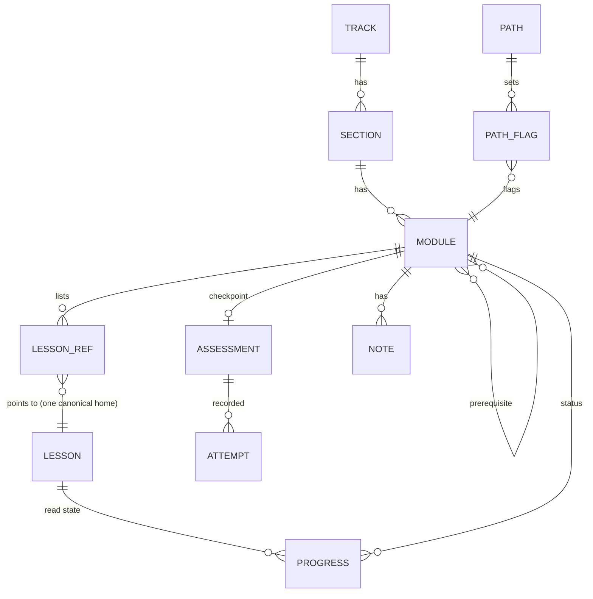

# Forward Deployed: Production Implementation Plan

Date: 5 October 2026. Author: planning pass over the four `.website_plan/` briefs and the current `site/` code.

---

## 0. Summary

Forward Deployed is a free, static learning platform for Applied AI and Forward Deployed Engineer (FDE) candidates. It runs on the existing Next.js 16 / React 19 / Tailwind v4 app in `site/`, deployed on Vercel. Today the live site serves four practice modules (`/modules/01`, `14`, `15`, `16`) plus a final-week section, and a clickable prototype of the full platform lives at `/demo` on sample data.

This plan turns the prototype into the production platform without writing new curriculum: every lesson is synced from a file that already exists in the repository (the grounding rule in `curriculum_plan.md`). The work runs in four phases. **Phase 0** settles the owner decisions that block content (third-party material, canonical homes) and adds CI. **Phase 1** ships the six-area navigation and the Learn area: 10 tracks, 53 module pages, real lessons for the 36 ready and 11 partly ready modules, honest Coming soon and On hold states, path picker, and lesson-level progress on `fd:v1` keys. **Phase 2** adds the Interview and Progress layers (mocks, dashboard, revision queue, readiness). **Phase 3** is version 2: optional accounts, projects, analytics.

## 1. Inputs, mode and assumptions

**Mode: hybrid.** Four brief files define the target; the existing `site/` app and its `/demo` prototype define the starting point. The plan covers the delta.

**Sources read:**

| Source | Contribution |
|---|---|
| `.website_plan/website_prompt.md` | Original product brief: name, positioning, IA, tracks, paths, interview framework, projects, progress tracker, dashboard, content model, quality standards, MVP and roadmap. Its analysis was answered by `00_Start_Here/Platform_Blueprint.html` (revision 3). |
| `.website_plan/prototype_prompt.md` | Prototype spec (already built and merged in PR #6). Its interaction rules, status rules, readiness formulas, a11y and responsive requirements carry over to production. |
| `.website_plan/curriculum_plan.md` | The production structure: 10 tracks, 16 sections, 53 modules, each with objective, scope, prerequisites, deliverable and the actual source files for its lessons. Status per module. |
| `.website_plan/module_source_audit.md` | Verdicts (36 full, 11 partial, 3 none, 3 on hold), the grounding rule, third-party material list, content recoverable from git history, owner open questions. |
| `site/` code and `00_Start_Here/Platform_Blueprint.html` | Current state (section 2). Blueprint §9 nav, §16 progress rules, §18 content model, §20 MVP, §21 roadmap. |
| `CLAUDE.md`, `site/specs/2026-09-27-content-architecture-and-editorial-style.md` | Constraints: ids never change, generated content never hand-edited, branch per task, PR before `main`, style guide. |

**Requirements:**

| ID | Requirement | Source |
|---|---|---|
| R1 | Product name "Forward Deployed" and tagline; positioning for seven personas | website_prompt §4–5, prototype_prompt |
| R2 | Six-area navigation (Start, Learn, Design, Practice, Interview, Progress) plus utility bar (Glossary, Library, Search) | prototype_prompt §2, blueprint §9 |
| R3 | 10 tracks T0–T9 with required/optional flags, objective, target learner, prerequisites, hours, exit competencies | curriculum_plan, website_prompt §7 |
| R4 | Hierarchy Track › Section › Module › Lesson, with exercise and checkpoint slots | curriculum_plan, prototype_prompt §2 |
| R5 | Module page fields: objective, scope boundary, prerequisites, deliverable, assessment, interview probe, common mistakes, effort | curriculum_plan, website_prompt §8 |
| R6 | Grounding rule: every lesson comes from an existing repository file; no new content written to fill gaps | curriculum_plan, module_source_audit |
| R7 | Module statuses Ready, Partly ready (gap shown as Coming soon), Coming soon, On hold are visible to learners | curriculum_plan |
| R8 | One canonical home per concept; other modules reference rather than repeat | website_prompt §3, §14 |
| R9 | Third-party material needs a per-item publishing decision (exclude, credit, rewrite) before going public | module_source_audit |
| R10 | Company-specific prep (T1.1, T8.4) and the coding kit (T8.5) stay on hold | module_source_audit |
| R11 | Seven learning paths plus two company variants, with a 10-question diagnostic and required/recommended/optional module flags | prototype_prompt §3, website_prompt §9 |
| R12 | Soft prerequisite gating: Blocked status and check card, learner can still open | prototype_prompt §2, §5 |
| R13 | Progress statuses (not started, in progress, blocked, ready for review, completed, needs revision, mastered, skipped) and their rules | prototype_prompt §5, website_prompt §12 |
| R14 | Revision queue with decay (14, 30, 60 days) and confidence 1–5 | prototype_prompt §5 |
| R15 | Interview and Portfolio readiness scores naming the weakest dimension | prototype_prompt §5 |
| R16 | Learner dashboard: next up with reason, readiness, revision queue, track progress, recent activity, saved items, finish-by date | prototype_prompt §3, website_prompt §13 |
| R17 | Interview area: five topic hubs, shared rubric, mock formats A–E, readiness exam | prototype_prompt §2, website_prompt §10 |
| R18 | Mock interviews (restored to `03_.../Mock_Interviews/`) available for practice | curriculum_plan T8.2 |
| R19 | Projects P1–P10 with full brief fields and completion rubric | website_prompt §11, prototype_prompt §3 |
| R20 | Bookmarks, notes, learning history | prototype_prompt §2, website_prompt §12 |
| R21 | Search (⌘K) across tracks, modules, lessons, cases, questions, glossary; filters on tracks, projects, questions | prototype_prompt §5 |
| R22 | Export, import and reset of progress; persistence across refresh; works when storage is blocked | prototype_prompt §5 |
| R23 | Accessibility: labelled controls, visible focus, keyboard dialogs and search, reduced motion, contrast in both themes | prototype_prompt §7 |
| R24 | Responsive at 375, 768 and 1280 px with no horizontal page scroll; light and dark themes | prototype_prompt §7–8 |
| R25 | Existing live routes, ids and the sync pipeline keep working; `npm run check:content` stays green | prototype_prompt §1, CLAUDE.md |
| R26 | Content quality standards: lesson shape, objectives, difficulty, time, versioning, freshness | website_prompt §15, blueprint §19 |
| R27 | MVP first, then version 2 (accounts, analytics, personalisation) and long-term items (AI feedback, community, certification) | website_prompt §16 |
| R28 | Content model entities with relationships that support reuse without duplication | website_prompt §14, blueprint §18 |
| R29 | Profile and portfolio (skills, artifacts, public preview) | prototype_prompt §3, website_prompt §12 |
| R30 | Business rules are pure functions with a self-check script; replaceable seams for auth, data, persistence, search | prototype_prompt §9 |
| R31 | Capstone and portfolio track (T9) with partial sources and Coming soon gaps | curriculum_plan T9 |
| R32 | Content recoverable from git history (`56cb673^`: incident logs, labs, readiness assessment, red-team fixtures, diagrams) is an owner decision | module_source_audit |
| R33 | Learner always knows where they are, what next, why, and what blocks progress | website_prompt §9 |
| R34 | No admin or community features in MVP; git is the CMS | blueprint §9, website_prompt §6 |

**Assumptions:**

- A1. The production areas live at top-level routes (`/start`, `/learn`, …) in the `(site)` route group, as blueprint §9 sitemap states. `/demo` stays as a noindex showcase until Phase 2 exit, then is retired.
- A2. "No new content" applies to lesson bodies. Checkpoint questions, path definitions, diagnostic questions and module metadata (objective, scope, probes) are product configuration the owner already approved in the blueprint, so they may be written. Checkpoint questions still need owner sign-off (Q4).
- A3. Lessons render the source file as it is (after link rewriting and heading normalisation). They are not rewritten into the §19 house lesson shape in this plan.
- A4. The site stays free, anonymous and static through Phase 2. No personal data leaves the browser.
- A5. The FDE Handbook (84 files) is the owner's own writing (audit open question 1).
- A6. The Vercel project that deploys `main` is `forward-deployed`, even though `site/.vercel/project.json` names `site`.

## 2. Current state

| Area | What exists | Evidence | Gap or problem |
|---|---|---|---|
| Stack | Next 16.3.5, React 19.2.8, Tailwind v4, TS 5, ESLint 9; 6 runtime deps (`marked`, `mermaid`, `next`, `react`, `react-dom`, `server-only`) | `site/package.json` | No test runner; no `engines` field though `check-parse.ts` needs Node with type stripping |
| Routes | Two root layouts: `(site)/layout.tsx` (live) and `demo/layout.tsx` (noindex). Live: `/`, `/guide`, `/learning-map`, `/glossary`, `/fde-last-day-prep/[guide]`, `/modules/[module]`, `/modules/[module]/[track]/[scenario]`, `/modules/[module]/story-bank`, `/search-index.json`. Demo: 28 routes covering all six areas | `site/src/app/` | No `/start`, `/learn`, `/progress` in production; no `not-found`, `error`, `loading`, `sitemap`, `robots` files |
| Components and tokens | 12 shared components (`ScenarioView`, `CaseStudyView`, `ReadingPanel`, `Progress` with `Ring`, `SearchDialog`, `ThemeToggle`, `Diagram`, …); 24 demo components; oklch tokens with `.dark` class theme; demo added `--danger`, `--review`, `--mastered` and soft variants | `site/src/components/`, `site/src/demo/components/`, `site/src/app/globals.css` | No radius or spacing tokens (radii hard-coded 3, 4, 8, 10 px, 0.75rem); demo components import demo-only types |
| Data and backend | No backend. Live progress in `fd:v1:*` (answers, scores, status, rows, read tabs per scenario). Demo state in `fd:demo:v1:learner:<userId>`. Pure rules in `src/demo/store/rules.ts` (`moduleStatus`, `checkPrerequisites`, `isMastered`, readiness, `finishBy`) | `site/src/lib/storage.ts`, `site/src/demo/store/` | Rules live under `demo/`; `scripts/check-demo-rules.ts` not wired into npm scripts |
| Content | Sync scripts read `03_` worksheets, `04_` behavioural, `02_` scenario packs and standalone designs, `07_` last day, `08_/Blitzy`; 201 generated files. Registry has 16 module slots (4 live, 12 planned). Demo `data/curriculum.ts` models all 53 modules with placeholder lessons | `site/scripts/*.mjs`, `site/src/lib/registry.ts`, `site/src/demo/data/curriculum.ts` | `01_Concept_Tutorials/`, `05_FDE_Delivery_and_Scoping/` and `03_/Mock_Interviews/` are not synced; no curriculum model in `src/lib/` |
| Quality | `check-parse.ts` validates structure, links, placeholders, glossary acronyms; ESLint; Claude hooks guard generated files | `site/scripts/check-parse.ts`, `.claude/hooks/` | No CI (`.github/` absent); no analytics or error tracking; no automated a11y or e2e tests |
| Deploy | Vercel builds `site/` on push; previews per branch | `CLAUDE.md`, `site/.vercel/project.json` | `.vercel/project.json` links project `site`, which CLAUDE.md says was deleted |

- **Keep:** the sync-then-snapshot pipeline, `check-parse.ts` as the content test suite, the token set, the `/modules/...` routes and their ids, and the demo's types, rules and components as the starting point.
- **Fix:** move pure rules and reusable components out of `src/demo/` into `src/lib/` and `src/components/`; add radius tokens; add CI; wire the rules self-check into npm scripts.
- **Replace:** demo sample data with a real `site/src/lib/curriculum.ts` plus synced lesson content; the six-item `NAV` in `editorial.ts` (labels may change, ids may not) with the six blueprint areas.

## 3. Product goals, users and success metrics

**Goal.** Give a candidate one place that tells them what to study, in what order, from material that exists, and shows when they are ready for an FDE or Applied AI loop.

**Personas** (blueprint §8; R1): Beginner; Experienced SWE moving into AI; Data engineer; ML engineer going to production; Architect or consultant; FDE candidate; Revision-only candidate. Mostly desktop study sessions of 30–90 minutes, with phone use for final-week revision.

**Jobs to be done, ranked:**

1. Tell me my path and the next thing to study (Start, Learn).
2. Teach me the concept from a trustworthy source (Learn lessons).
3. Let me practise under interview conditions and see if I am ready (Practice, Interview, Progress).

**Success metrics** (measurable only once opt-in analytics ship in Phase 3; until then, verified by manual walkthroughs):

| Metric | Target | Measured by |
|---|---|---|
| First-time visitor reaches a lesson | ≤ 2 clicks from `/` | Route audit in QA-03; later analytics funnel |
| Module pages with at least one real lesson | 47 of 53 (36 ready + 11 partly) after owner decisions | `check:content` count |
| Broken internal links | 0 | `check:content` |
| Lighthouse accessibility score on each template | ≥ 95 | QA-05 |
| Learners who choose a path complete one module in week 1 | 40 % | Phase 3 analytics |

**Decisions.**

| Decision | Why | Rejected alternative |
|---|---|---|
| Ship structure for all 53 modules, with honest Coming soon and On hold states | Learners see the whole map and what is missing; matches R7 | Hide modules without content (map looks complete but lies about coverage) |
| Lessons are canonical repository files, shown as written | Grounding rule R6; owner time goes into decisions, not rewriting | Rewrite into the house lesson shape now (large effort, risks drift from sources) |
| Free and anonymous through Phase 2 | No backend to run, no personal data, fits current static deploy | Accounts in MVP (blueprint defers to V2) |

**Tasks.**

| ID | Outcome | Size | Depends on |
|---|---|---|---|
| PM-01 | Owner decision recorded per third-party item (exclude, keep with credit, rewrite) in `curriculum.ts` `publish` field | S | — |
| PM-02 | Owner confirms FDE Handbook authorship (A5) | S | — |
| PM-03 | Owner decides canonical home for each multi-use lesson file (see DATA-03 list) | M | DATA-03 |
| PM-04 | Owner decides whether checkpoint questions may be authored (A2) and who writes them | S | — |
| PM-05 | Owner decides which git-history folders to restore (`56cb673^`: incident logs, labs, readiness assessment, red-team fixtures, diagrams) | S | — |

**Acceptance criteria.**

- Every assumption A1–A6 is either confirmed or replaced by a recorded decision in section 15.
- `curriculum.ts` carries a `publish` value for every lesson flagged third-party in `curriculum_plan.md`.

**Non-goals:** admin UI, community, payments, certification, AI feedback, employer profiles (R27, R34); writing lessons to fill Coming soon gaps (R6).

## 4. Information architecture and sitemap

**Goal.** One stable map of six areas where every existing page keeps its URL and every new page has a slug that never changes.

**Sitemap** (new routes in bold; all in the `(site)` route group):

```text
/                                   Home (rewritten as product landing)
/start                              Path picker + diagnostic
/start/paths/[pathId]               Path detail and sequence
/learn                              Curriculum overview (10 tracks)
/learn/[trackSlug]                  Track detail (sections, modules)
/learn/[trackSlug]/[moduleSlug]     Module page
/learn/[trackSlug]/[moduleSlug]/[lessonSlug]   Lesson page
/design                             Casebook index → links into /modules/15-fde-case-studies/...
/practice                           Worksheets, mocks and projects index → links into /modules/01..., /modules/14...
/practice/mocks/[mockSlug]          Mock interview (synced from 03_/Mock_Interviews)
/interview                          Interview hubs index
/interview/[hubSlug]                Topic hub
/interview/final-week               → existing /fde-last-day-prep (redirect, not a copy)
/progress                           Dashboard (client-rendered from localStorage)
/progress/revision                  Revision queue
/progress/history                   Activity history
/progress/bookmarks                 Bookmarks
/settings                           Path, weekly hours, export/import, reset
/glossary  /library                 Utility bar
--- existing, unchanged ---
/modules/[module]/...               Live practice and case-study pages
/modules/[module]/story-bank
/fde-last-day-prep/[guide]
/guide  /learning-map               Kept; /learning-map gets a banner pointing to /learn
```

**Navigation model.** Desktop top bar: six areas plus Glossary, Library, ⌘K search, theme toggle. Track, module and lesson pages add a left sidebar with the section and module tree (drawer below 1024 px). Mobile: slide-over menu plus a bottom bar with Learn, Practice, Interview, Progress. Breadcrumbs on every page below area level: Learn › Track › Section › Module › Lesson.

**URL and slug rules.**

| Decision | Why | Rejected alternative |
|---|---|---|
| Track and module URLs use slugs (`/learn/llm-and-retrieval/retrieval-hybrid-rerank`), not codes | Codes already changed once (T8.1/T8.2 merged on 5 October 2026); progress keys and links must survive renumbering | `/learn/t2/t2-4` (breaks on renumber) |
| Codes (`T2.4`) are display labels stored on the module | Readers think in codes; labels may change per CLAUDE.md | Encode code in the slug |
| Lesson slug = kebab of the source filename, fixed at first publish and stored in `curriculum.ts` | Stable across title edits | Derive from heading each sync (breaks when a heading changes) |
| Design, Practice and Interview indexes link into existing `/modules/...` pages | No duplicate pages; existing progress keys keep working (R8, R25) | Move scenario pages under `/design/...` (breaks URLs and `fd:v1` keys) |
| Track slugs must not collide with existing track ids in `editorial.TRACKS` | CLAUDE.md: track ids unique site-wide | Reuse names like `core` |

**Page templates.**

| Template | Routes |
|---|---|
| Landing | `/` |
| Area index | `/start`, `/learn`, `/design`, `/practice`, `/interview`, `/library` |
| Track | `/learn/[trackSlug]` |
| Module | `/learn/[trackSlug]/[moduleSlug]` |
| Reading (lesson, mock) | `/learn/.../[lessonSlug]`, `/practice/mocks/[mockSlug]` |
| Hub | `/interview/[hubSlug]` |
| Dashboard and lists | `/progress`, `/progress/*`, `/settings` |
| Existing worksheet and case-study templates | `/modules/...` (unchanged) |

**Tasks.**

| ID | Outcome | Size | Depends on |
|---|---|---|---|
| UX-01 | Final slug table for 10 tracks and 53 modules committed in `curriculum.ts`, checked for collisions with `editorial.TRACKS` ids | M | DATA-01 |
| UX-02 | `NAV` in `editorial.ts` relabelled to the six areas; existing hrefs reached from area indexes | S | FE-03 |
| UX-03 | Breadcrumb spec per template (labels, truncation at 375 px) | S | UX-01 |

**Acceptance criteria.**

- Every route in the sitemap is reachable from the top bar within two clicks.
- No existing URL returns 404 after Phase 1 (checked by crawling the pre-Phase-1 sitemap).
- No slug contains a module code.

## 5. UX flows and key screens

**Goal.** Make the top three jobs take the fewest steps, and make every empty or missing state say what to do next (R33).

**Critical flows.**

1. **Pick a path.** `/` → "Start learning" → `/start` → 10-question diagnostic (or pick persona directly) → recommended path with sequence → "Start first module". Success: path saved to `fd:v1:path`; Learn shows required/recommended/optional flags. Failure: storage blocked → path shown for the session with a "Progress won't be saved in this browser" notice.
2. **Study a module.** `/learn` → track → module page (objective, scope, prerequisites with live status, lessons, deliverable, probe) → lesson → "Mark read" → next lesson → module rolls to In progress, then to Completed when all published lessons are read and confidence is rated. Blocked prerequisites show the check card with "Open anyway" (R12).
3. **Hit a gap.** Module status Partly ready shows published lessons first, then a "Coming soon in this module" panel listing the gap text from `curriculum_plan.md`. Coming soon modules show objective, scope and the related modules that partly cover the topic. On hold modules say "Paused, will return" with no source paths shown publicly.
4. **Practise.** `/practice` → worksheet (existing `/modules/01/...`) or mock → self-score on the five rubric dimensions → score saved; dashboard readiness updates (Phase 2).
5. **Check readiness.** `/progress` → next up with reason, revision queue, readiness with weakest dimension, finish-by date from weekly hours (Phase 2).
6. **Revise.** Revision queue item → "Review now" → rate confidence ≥ 4 → item leaves the queue (Phase 2).

**Key screens.**

| Screen | Primary action | Hierarchy | Mobile vs desktop |
|---|---|---|---|
| Module page | Continue to next unread lesson | Code and title, status badge, objective, scope boundary, prerequisites, lesson list, deliverable, interview probe, common mistakes, related modules | Sidebar becomes drawer; prerequisite card stays above lessons |
| Lesson page | Mark read and go next | Breadcrumb, title, source note ("From the FDE Handbook"), body, credit line if third-party, prev/next, module progress | Prev/next sticky at bottom on mobile |
| Track page | Start or continue | Objective, target learner, hours, exit competencies, sections (collapsible), modules with status | Sections collapsed by default under 768 px |
| Path detail | Start first module | Persona, sequence with flags, skip criteria, readiness criteria | Single column |
| Dashboard | Open next-up item | Next up, readiness gauges, revision queue, track progress, recent activity | Grid stacks to one column |

**States per data view:** loading (skeleton for client-read progress only; content is static), empty ("No bookmarks yet. Use the bookmark button on any lesson."), error (storage blocked notice; invalid import JSON message naming the problem), partial (Partly ready module), success (toast on mark read, import, reset).

**Microcopy.** British English, title case with serial comma in titles, spoken interview voice (style guide). Buttons use verbs: "Mark read", "Open anyway", "Start module". Errors say what happened and what to do: "That file isn't a Forward Deployed export. Choose a .json file exported from Settings." Use "Module" only for curriculum modules.

**Tasks.**

| ID | Outcome | Size | Depends on |
|---|---|---|---|
| UX-04 | Wireframes for module, lesson, track, path, gap states (Partly ready, Coming soon, On hold) at 375 and 1280 px | M | UX-01 |
| UX-05 | Diagnostic copy (10 questions) and scoring table mapped to the seven paths, ported from `src/demo/data/paths.ts` and reviewed by owner | S | PM-04 |
| UX-06 | Copy deck for empty, error and gap states | S | UX-04 |
| UX-07 | Dashboard wireframe for production (no sample data, empty-first) | M | UX-04 |

**Acceptance criteria.**

- A new visitor can go from `/` to a lesson in two clicks.
- Every data-driven view has a designed empty state and error state.
- Gap states never show internal repository paths for on-hold or excluded material.

## 6. Visual design system

**Goal.** Keep the live site's look; formalise the tokens the demo added so production and existing pages share one system.

**Decisions.**

| Decision | Why | Rejected alternative |
|---|---|---|
| Keep oklch tokens in `globals.css` and the `.dark` class switch | Already shipped and contrast-checked on live pages | New palette or a component library |
| Promote demo tokens (`--danger`, `--review`, `--mastered`, `--warning-soft`, `--warning-text` and soft variants) to the core set | Production statuses need them | Keep them demo-only |
| Add radius tokens | Five hard-coded radii today cause drift | Leave ad hoc |

**Values.**

- **Color roles:** background `--bg`; surface `--surface`, `--surface-2`; border `--border`, `--border-strong`; text `--text`, muted `--text-muted`, subtle `--text-subtle`; accent `--accent`, `--accent-hover`, `--accent-soft`, `--accent-ring`; success `--success`/`--success-soft`; warning `--warning`/`--warning-soft`/`--warning-text`; danger `--danger`/`--danger-soft`; review (needs revision) `--review`/`--review-soft`; mastered `--mastered`/`--mastered-soft`. Light and dark values for each. Text on surface ≥ 4.5:1; badges and focus rings ≥ 3:1 against neighbours.
- **Status mapping (one colour and one icon each):** Not started = `--text-subtle`, hollow circle; In progress = `--accent`, half circle; Blocked = `--warning`, lock; Ready for review = `--accent`, flag; Completed = `--success`, check; Needs revision = `--review`, rotate arrow; Mastered = `--mastered`, star; Skipped = `--text-subtle`, skip arrow. Gap labels: Coming soon = `--text-subtle` outline pill; On hold = `--warning` outline pill.
- **Typography:** Inter (`--font-sans`) and `--font-mono`. Scale: 12/16, 14/20, 16/24 (body), 18/28, 20/28, 24/32, 30/36, 36/40. Weights 400, 500, 600. Reading measure 68ch max on lesson pages.
- **Spacing and layout:** Tailwind 4 px scale. Container max 1200 px; reading column 720 px; sidebar 280 px. Gutter 16 px under 640 px, 24 px above. Breakpoints: Tailwind defaults (`sm` 640, `md` 768, `lg` 1024, `xl` 1280).
- **Radius:** pins Tailwind v4's scale so existing `rounded-*` classes keep their look: `--radius-sm` 4 px (badges, inputs), `--radius-md` 6 px (buttons), `--radius-lg` 8 px (cards, panels), `--radius-xl` 12 px (dialogs), full for pills. See `2026-10-05-design-tokens.md`.
- **Elevation:** `--shadow` for cards on hover only, `--shadow-lg` for dialogs and the ⌘K panel. Borders carry most separation.
- **Motion:** 150 ms ease-out for hover and toggles, 200 ms for drawers and dialogs. Under `prefers-reduced-motion: reduce`, durations are 0 and no transforms.
- **Icons and imagery:** inline SVG line icons at 16 and 20 px, `currentColor`. No stock photos, no emoji section markers, no gradient hero (prototype_prompt §7). Diagrams are the only imagery (mermaid).
- **Where tokens live:** CSS variables in `:root` and `.dark` in `site/src/app/globals.css`, mapped through `@theme inline` so Tailwind utilities (`bg-surface`, `text-muted`, `rounded-md`) use them.

**Tasks.**

| ID | Outcome | Size | Depends on |
|---|---|---|---|
| DS-01 | Radius tokens added to `@theme`; hard-coded radii replaced across `src/components/` and `src/demo/components/` | S | — |
| DS-02 | Demo status tokens moved to the core block with comments removed; contrast of every token pair verified in both themes and recorded in the spec | S | — |
| DS-03 | `StatusBadge` primitive with the eight statuses plus Coming soon and On hold, colour + icon + text label, tooltip with the rule | S | DS-02 |
| DS-04 | Type scale documented in `site/specs/` and applied to the lesson reading column | S | — |

**Acceptance criteria.**

- No raw hex, rgb or px radius values in new components (grep check).
- Every status is distinguishable without colour (icon and text label).
- All token pairs meet the contrast targets above in light and dark.

## 7. Component inventory

**Goal.** Build production from components that already exist, moved out of the demo folder and typed against the real curriculum model.

| Component | Variants and states | Used on | Exists today? | Task |
|---|---|---|---|---|
| Button, Link-button | primary, secondary, ghost; disabled, loading | all | Partly (`src/demo/components/ui.tsx`) | FE-05 |
| StatusBadge | 8 statuses + Coming soon + On hold | module, track, dashboard | Demo | DS-03 |
| ProgressBar, Ring | 0–100, indeterminate | track, module, dashboard | Yes (`Progress.tsx` `Ring`) | FE-05 |
| Card (TrackCard, ModuleCard) | default, flagged required/optional, skipped | learn, path | Demo | FE-06 |
| AppShell, TopNav, SideNav (tree), MobileNav, BottomBar | collapsed, expanded, active item | all new routes | Demo `AppShell.tsx` | FE-03 |
| Breadcrumbs | truncated on mobile | below area level | Demo | FE-03 |
| SectionAccordion | open, closed | track | Demo `TrackTree.tsx` | FE-06 |
| PrerequisiteCard | blocked, satisfied; "Open anyway" | module | Demo `ModuleIslands.tsx` | FE-08 |
| GapPanel | Partly ready, Coming soon, On hold | module, track | New | FE-07 |
| LessonReader | body, source note, credit line, prev/next | lesson | Partly (`ReadingPanel`, `Diagram`) | FE-07 |
| LessonActions | Mark read, bookmark, note | lesson | Demo `LessonActions.tsx` | FE-09 |
| ConfidenceControl | 1–5, dated | module, hub question | Demo | FE-09 |
| PathPicker, Diagnostic | step n of 10, result | start | Demo `PathPicker.tsx` | FE-10 |
| SearchDialog | idle, loading, results, empty | global | Yes (`SearchDialog.tsx`) | FE-12 |
| FilterBar | chips, reset | learn, practice, interview | Demo | FE-06 |
| RubricScorer, MockTimer | 5 dimensions × 1–4; running, paused, done | mocks | Demo `InterviewRunners.tsx` | FE-15 |
| ReadinessGauge, StatCard, ActivityTimeline, RevisionQueueList | empty, populated | progress | Demo `Dashboard.tsx`, `ProgressViews.tsx` | FE-16 |
| ConfirmDialog, Toast, EmptyState, ErrorState, Skeleton | — | all | Demo `feedback.tsx` | FE-05 |
| SettingsView (export, import, reset) | success, invalid file | settings | Demo `SettingsView.tsx` | FE-17 |

**Keyboard and screen-reader behaviour.** Accordions are `button` + `aria-expanded`. SideNav tree uses nested lists with `aria-current="page"`. Dialogs trap focus, close on Escape, return focus to the trigger, and have `aria-labelledby`. ⌘K and `/` open search; arrow keys move results; Enter opens. RubricScorer is a radio group per dimension. Toasts use `role="status"`. StatusBadge tooltip text is also in `aria-describedby`.

**Decisions.**

| Decision | Why | Rejected alternative |
|---|---|---|
| Move reusable demo components to `src/components/learn/` and `src/components/progress/`, typed on `src/lib/curriculum.ts` types; demo imports them back | One implementation; demo keeps working | Copy and fork (two versions drift) |
| No component library | Zero-dependency stance holds; components exist | shadcn/ui (adds Radix deps and a second style) |

**Tasks:** see IDs in the table; all are defined in section 8.

**Acceptance criteria.**

- Each interactive component passes keyboard-only use and has an accessible name.
- `src/demo/` contains no component that production also needs.

## 8. Frontend architecture

**Goal.** Static pages for all content, small client islands for progress, and one data module so the backend can change later without touching UI.

**Decisions.**

| Decision | Why | Rejected alternative |
|---|---|---|
| Keep Next 16 App Router, static generation for every content route with `generateStaticParams` and `export const dynamicParams = false` | Content changes only at build; zero server cost; matches existing `/modules` pages | Server rendering per request (no benefit for static content) |
| Lesson HTML rendered at build with `marked` into Server Components; mermaid hydrated by the existing `Diagram` client component | Same pipeline as live pages | MDX (new toolchain, sources are plain markdown) |
| `/progress/*` and `/settings` render a static shell; data reads from localStorage in client components behind a skeleton | Progress is per-browser; avoids hydration mismatch (the demo hit this with `Date.now()`) | Cookies + server render (needs a backend) |
| New production routes in `(site)` group, sharing its root layout | One header, one theme script; `/demo` keeps its own layout until retired | Third root layout |
| Push `'use client'` to islands only: LessonActions, ConfidenceControl, PrerequisiteCard status, PathPicker, FilterBar, SearchDialog, dashboard widgets | Keeps page JS small; Server Components can pass static props in | Client pages (large bundles) |

**Folder structure.**

```text
site/src/lib/curriculum.ts        Tracks, sections, modules, lesson refs, paths (pure data, no runtime imports: read by .mjs sync)
site/src/lib/curriculum-types.ts  Types shared by curriculum.ts and UI
site/src/lib/progress/rules.ts    Pure rules (moved from src/demo/store/rules.ts)
site/src/lib/progress/store.ts    fd:v1 learner store (read/write, probe, events)
site/src/lib/learn.ts             Server-only loaders for content/learn/** (like lib/content.ts)
site/src/components/learn/        Track, module, lesson, gap, prerequisite components
site/src/components/progress/     Dashboard widgets, settings, history
site/src/app/(site)/{start,learn,design,practice,interview,progress,settings,library}/
site/scripts/learn.mjs            Lesson sync (called by sync-content.mjs)
```

**State strategy.**

| State | Lives in | Notes |
|---|---|---|
| Current route, filters, search query | URL (`searchParams` for filters on `/learn`, `/practice`) | Shareable; read in client FilterBar with `useSearchParams` inside `Suspense` |
| Curriculum, lessons, mocks | Build-time files (`content/learn/**`) and `curriculum.ts` | Static |
| Learner progress, path, confidence, notes, bookmarks, attempts | localStorage `fd:v1:*` | One versioned JSON per concern (below) |
| Theme | `fd:v1:theme` (existing) | Unchanged |

New keys (all under the existing `fd:v1` prefix so the existing `ClearAllButton` and export cover them):

- `fd:v1:path` = `{ pathId, variant?, weeklyHours, chosenAt }`
- `fd:v1:learn:lesson:<moduleSlug>/<lessonSlug>` = `{ readAt }`
- `fd:v1:learn:module:<moduleSlug>` = `{ confidence: {value, at}[], notes, openedAnywayAt?, skipped? }`
- `fd:v1:learn:attempts:<assessmentId>` = `Attempt[]` (Phase 2)
- `fd:v1:bookmarks` = `Bookmark[]`; `fd:v1:activity` = last 200 `ActivityEvent`s (Phase 2)

**Data fetching and errors.** Server loaders in `src/lib/learn.ts` (marked `server-only`) read `content/learn/manifest.json` and lesson files. Missing lesson file at build fails the build (no silent empty pages). Add `src/app/(site)/not-found.tsx` and `error.tsx`. Client store wraps every read and write in try/catch and exposes `storageAvailable` for the blocked notice.

**Forms and validation.** Only import (JSON) needs validation: a hand-written type guard in `progress/store.ts` checks version and shape, rejects unknown keys, and reports the first problem. No schema library.

**Client bundle budget.** Lesson and module pages: ≤ 90 KB gzipped first-load JS beyond the framework baseline; dashboard ≤ 140 KB. Mermaid loads only on pages with diagrams (dynamic import, as today). Enforced by reading `next build` output in CI and failing above budget (OPS-02).

**Tasks.**

| ID | Outcome | Size | Depends on |
|---|---|---|---|
| FE-01 | `src/demo/store/rules.ts` moved to `src/lib/progress/rules.ts`; demo imports it; `check-demo-rules.ts` renamed `check-progress-rules.ts` and added as `npm run check:rules` | S | — |
| FE-02 | `src/lib/progress/store.ts` with the `fd:v1` keys above, storage probe, `fd:progress` change event, export/import/reset | M | FE-01 |
| FE-03 | Production AppShell: TopNav (six areas + utilities), SideNav tree, MobileNav, BottomBar, Breadcrumbs, moved from demo and used in `(site)/layout.tsx` without changing existing `/modules` page bodies | L | UX-02, DS-01 |
| FE-04 | `src/lib/learn.ts` loaders and `generateStaticParams` for `/learn/[trackSlug]`, `/[moduleSlug]`, `/[lessonSlug]` with `dynamicParams = false` | M | DATA-02 |
| FE-05 | Primitives moved from demo (`ui.tsx`, `feedback.tsx`) into `src/components/` | S | DS-01 |
| FE-06 | `/learn` overview (10 tracks, flags from chosen path, filters by level, topic, required) and track page with SectionAccordion | M | FE-04, FE-05 |
| FE-07 | Module page and lesson page, including GapPanel and LessonReader with source note and credit line | L | FE-04, DS-03 |
| FE-08 | PrerequisiteCard and Blocked status driven by `checkPrerequisites`, with "Open anyway" | S | FE-02, FE-07 |
| FE-09 | LessonActions (mark read, bookmark, note) and ConfidenceControl, with module rollup weighted by lesson minutes | M | FE-02, FE-07 |
| FE-10 | `/start` diagnostic and `/start/paths/[pathId]`; path flags shown on `/learn` and module pages | M | FE-02, UX-05 |
| FE-11 | `/design`, `/practice`, `/interview` area index pages linking into existing `/modules/...` pages and `/fde-last-day-prep` | M | FE-03 |
| FE-12 | Search index extended with tracks, modules and lessons; index split into per-area files fetched on demand to keep each under 500 KB | M | FE-04 |
| FE-13 | New landing page at `/` (name, tagline, personas, six areas, CTAs) | M | FE-03 |
| FE-14 | `not-found.tsx`, `error.tsx`, `loading.tsx` for `(site)` | S | FE-03 |
| FE-15 | `/practice/mocks/[mockSlug]` reading view with MockTimer and RubricScorer; attempts saved | M | DATA-06, FE-02 |
| FE-16 | `/progress` dashboard, `/progress/revision`, `/progress/history`, `/progress/bookmarks` on real data | L | FE-09, FE-15 |
| FE-17 | `/settings`: path, weekly hours, export, import, reset with ConfirmDialog | S | FE-02 |
| FE-18 | Interview hubs `/interview/[hubSlug]` indexing existing question sources (decomposition bank, leadership principles, hiring-manager round, scenario packs) by link, not copy | M | DATA-07 |
| FE-19 | Retire `/demo`: redirect `/demo/*` to `/`, remove `src/demo/` and its search route | S | Phase 2 exit |

**Acceptance criteria.**

- `next build` lists every `/learn/**` route as static (○ or ●).
- No page under `/learn` has `'use client'` at file level.
- Refreshing any page keeps progress; with storage blocked, pages render and show the notice.
- Lesson page first-load JS within budget.

## 9. Backend, data and APIs

**Goal.** No backend through Phase 2; define the data model now so version 2 accounts can sync the same records.

**Decisions.**

| Decision | Why | Rejected alternative |
|---|---|---|
| No backend in Phases 0–2; all learner data in localStorage | Blueprint §20 MVP; zero ops; no personal data | Database from day one |
| Learner records shaped as the blueprint §18 entities (`ProgressRecord`, `Attempt`, `Review`, `Bookmark`, `Note`, `ActivityEvent`) with stable ids and `updatedAt` | Version 2 sync can upload them as-is and merge by `updatedAt` | Ad hoc keys per widget |
| Version 2 (Phase 3) accounts use a Vercel Marketplace Postgres (Neon or Supabase) plus Auth.js or Supabase Auth, with sync as an opt-in | Fits the Vercel deploy; Postgres handles the relational model | Firebase (document model fits progress poorly; new vendor) |

**Data model** (build-time content + client learner state):



- **Track:** `slug`, `code` (T0–T9), `title`, `objective`, `forWhom`, `prerequisites[]`, `required` (`yes` | `no` | `fde-path` | `candidates`), `estHours`, `exitCompetencies[]`.
- **Section:** `slug`, `title`, `whyItMatters`, `outcomes`, `exercise`, `assessment`, `interviewRelevance`, `doneWhen`.
- **Module:** `slug`, `code`, `title`, `status` (`ready` | `partly` | `coming-soon` | `on-hold`), `estMinutes`, `objective`, `scope`, `prerequisites` (module slugs), `deliverable`, `assessment`, `interviewProbe`, `commonMistakes[]`, `lessons` (lesson slugs, home first), `seeAlso` (lesson slugs homed elsewhere), `gapNote?`, `relatedModules[]`.
- **Lesson:** `slug`, `title` (display, emoji stripped), `source` (repo path), `homeModule`, `publish` (`own` | `credited` | `excluded` | `pending`), `credit?`, `estMinutes`.
- **Path:** `id`, `persona`, `variantOf?`, `moduleFlags: Record<moduleSlug, 'required' | 'recommended' | 'optional' | 'skip'>`, `estHours`, `readinessCriteria`.

**API surface (Phase 3 only).**

| Endpoint | Method | Input | Output | Auth | Errors |
|---|---|---|---|---|---|
| `/api/progress` | GET | — | learner records since `?since=` | session | 401 |
| `/api/progress` | PUT | records with `updatedAt` | merged records | session | 400 invalid shape, 413 > 1 MB, 429 |
| `/api/account` | DELETE | — | 204 | session | 401 |

Validation happens in the route handler with the same type guard as import (FE-02). Writes are idempotent: last-writer-wins per record id and `updatedAt`. Rate limit 60 writes per minute per user (Vercel Firewall rule or route-level counter).

**Tasks.**

| ID | Outcome | Size | Depends on |
|---|---|---|---|
| BE-01 | Learner record types in `src/lib/progress/types.ts` with `id` and `updatedAt` on every record | S | FE-01 |
| BE-02 | Phase 3 spike: auth provider and Postgres choice, schema, cost note | M | Phase 2 exit |
| BE-03 | Phase 3: `/api/progress` GET/PUT with merge, validation, rate limit | L | BE-02 |
| BE-04 | Phase 3: account deletion and data export endpoints | M | BE-03 |

**Acceptance criteria.**

- Phases 0–2: no network request carries learner data (verified in DevTools on `/progress`).
- Phase 3: a learner who signs in on a second browser sees the same progress after one sync; deleting the account removes all rows.

## 10. Content and CMS pipeline

**Goal.** Sync real lessons from root sources into `site/content/learn/` with the same guarantees the live modules have: committed snapshot, link rewriting, `check:content` validation.

**Decisions.**

| Decision | Why | Rejected alternative |
|---|---|---|
| Git is the CMS; `curriculum.ts` is the single map from module to source files | Existing pattern (`editorial.ts`); reviewable in PRs | Headless CMS (cost, second source of truth) |
| `curriculum.ts` has no runtime imports, so `.mjs` sync scripts can import it | Same rule as `editorial.ts` and `glossary.ts` | Separate JSON (loses types) |
| New `scripts/learn.mjs`, called from `sync-content.mjs`, writes `content/learn/<trackSlug>/<moduleSlug>/<lessonSlug>.md` and `content/learn/manifest.json` | Matches the per-module pattern; committed snapshot keeps Vercel builds working | Read root files at request time (Vercel root is `site/`; root files are not available) |
| Each source file is copied once to its home module; other modules list it under "Also useful" and link to the home lesson | One canonical home (R8); no duplicate pages | Copy the file into each module that uses it |
| `publish: 'excluded'` and `'pending'` lessons are never written to `content/` | Third-party material stays out until decided (R9) | Publish then remove |
| Lessons with `publish: 'credited'` render a credit line from `credit` | Owner may keep with credit | Silent inclusion |
| Lesson bodies are not rewritten; sync only normalises: strips emoji from H1, demotes headings so the page has one H1, rewrites repo links, keeps mermaid blocks | Grounding rule R6, A3 | Transform into house shape |

**Content types:** Track, Section, Module, Lesson (from `01_Concept_Tutorials/**`, `05_FDE_Delivery_and_Scoping/**`, `04_Behavioral_and_Leadership/**`, `07_Last_Day_Revision/**`, `00_Start_Here/**`), Scenario pack (existing module 15), Worksheet (existing module 01), Mock (new from `03_Practice_Worksheets_and_Keys/Mock_Interviews/`), Path.

**Canonical-home conflicts to resolve** (DATA-03 produces the full list; known examples):

| Source file | Listed in | Proposed home |
|---|---|---|
| `GenAI_Engineering_Modules/Module_10_Backend_FastAPI_Deployment.md` | T1.2, T1.4 | T1.2 (T1.4 links) |
| `GenAI_Engineering_Modules/Module_01_RAG_Fundamentals_Core_Components.md` | T2.1, T2.2 | T2.2 (T2.1 links) |
| `07_Last_Day_Revision/module-12-reliability-and-failure-handling.md` | T1.5, T8.3 | Already live at `/fde-last-day-prep`; T1.5 and T8.3 link to it rather than re-sync |
| `03_.../Customer_Discovery_Worksheets/*`, `System_Design_Worksheets/*` | T6.1, T8.1 | Already live in module 01; T8.1 module page links to `/modules/01-...` |
| `02_.../Scenario_Packs_G01_G20/*`, `Standalone_Designs/*` | T4.x, T5.4, T5.5, T6.x | Already live in module 15; Learn modules link to `/modules/15-...` |

Rule: material already live under `/modules/...` or `/fde-last-day-prep` is never re-synced into `/learn`; module pages link to the existing page as a lesson entry of kind `external-live`.

**Authoring workflow.** Edit root source → `npm run sync` → `npm run check:content` → commit source and snapshot on a `content/` branch → PR → Vercel preview check → merge.

**Validation added to `check-parse.ts`:**

- every `curriculum.ts` lesson with `publish` in (`own`, `credited`) exists in `content/learn/**`; no file exists for `excluded` or `pending`;
- each lesson source appears as a home in exactly one module;
- every module prerequisite slug resolves; no prerequisite cycles;
- module `status` matches content (a `ready` module has ≥ 1 published lesson; `coming-soon` has 0);
- no `content/learn/**` link points into the repository;
- slugs unique and unchanged versus the previous manifest (an id-change guard: fails if a slug present in the committed manifest disappears without an entry in a `RENAMED` map);
- acronyms in new lessons are in `GLOSSARY` or `NOT_ACRONYMS`.

**Media.** Mermaid only, rendered client-side as today. Images in sources (if any) are copied to `public/learn/` with alt text required; missing alt fails the check.

**Tasks.**

| ID | Outcome | Size | Depends on |
|---|---|---|---|
| DATA-01 | `src/lib/curriculum.ts`: 10 tracks, 16 sections, 53 modules with every field from `curriculum_plan.md`, statuses and gap notes; types in `curriculum-types.ts` | L | — |
| DATA-02 | `scripts/learn.mjs` sync with link rewriting, heading normalisation, emoji stripping, credit line, snapshot fallback | L | DATA-01, PM-01 |
| DATA-03 | Script report of every source file listed in more than one module (the "41 entries" audit) and proposed homes | S | DATA-01 |
| DATA-04 | `check-parse.ts` extended with the learn checks above | M | DATA-02 |
| DATA-05 | Glossary pass: add acronyms surfaced by the new lessons to `glossary.ts` | M | DATA-02 |
| DATA-06 | `scripts/mocks.mjs` syncing `03_.../Mock_Interviews/` (5 short + 5 full + README) to `content/mocks/`; rubric dimensions parsed from each scorecard section | M | DATA-01 |
| DATA-07 | Interview hub definitions in `curriculum.ts`: five hubs, each listing existing question sources by link and the related modules | M | DATA-01 |
| DATA-08 | Update CLAUDE.md "Layout" and "Content pipeline" bullets: `01_`, `05_` and `Mock_Interviews` now feed the site | S | DATA-02, DATA-06 |
| DATA-09 | Phase 3: restore chosen git-history folders (PM-05) into root sources and map them to T6.6, T9.1, T8.3 | M | PM-05 |

**Acceptance criteria.**

- `npm run sync` from a clean clone without root sources still builds from the committed snapshot.
- `check:content` fails if a third-party `pending` lesson appears in `content/learn/`.
- Module pages for already-live material link to the existing page and do not duplicate it.

## 11. Accessibility, performance and SEO

**Goal.** Every page meets WCAG 2.2 AA, loads fast on a mid-tier phone, and is findable.

**Decisions.**

| Decision | Why | Rejected alternative |
|---|---|---|
| WCAG 2.2 AA, checked with axe in Playwright on each template plus manual keyboard and screen-reader passes | Automated tools miss focus order and announcements | Lighthouse only |
| Per-page metadata via `generateMetadata` on every new dynamic route | Lessons are the search entry points | One site-wide description |
| `sitemap.ts` and `robots.ts` in `src/app/`; `/demo` and `/progress/*`, `/settings` disallowed | No sitemap today; learner-only pages have no search value | Static `public/sitemap.xml` (goes stale) |

**Targets.**

- Manual checks per template: keyboard-only path through the primary flow; VoiceOver on Safari and NVDA on Firefox for module, lesson, diagnostic, dialogs; zoom to 200 % and 400 % reflow; reduced motion; both themes.
- Core Web Vitals (p75, mobile): LCP < 2.5 s, INP < 200 ms, CLS < 0.1. Lesson pages carry no images except diagrams; Inter loaded with `next/font` (`display: swap`).
- JS budgets as in section 8. HTML for the longest lesson < 200 KB.
- SEO: `title` = "{Lesson} · {Module code} · Forward Deployed"; description from module objective; canonical URL on each page; Open Graph title and description; `BreadcrumbList` and `Course`/`LearningResource` JSON-LD on track and lesson pages.
- Analytics events (Phase 3, opt-in, cookieless Vercel Web Analytics): `path_chosen`, `lesson_read`, `module_completed`, `mock_scored`, `export_used`. These map to section 3 metrics.

**Tasks.**

| ID | Outcome | Size | Depends on |
|---|---|---|---|
| A11Y-01 | axe checks in Playwright for landing, learn, track, module, lesson, start, progress, settings, existing scenario page | M | QA-02 |
| A11Y-02 | Manual audit report per template (keyboard, screen reader, zoom, reduced motion) with fixes filed | M | Phase 1 build |
| A11Y-03 | Skip link, focus-visible ring using `--accent-ring`, landmark roles in the new AppShell | S | FE-03 |
| PERF-01 | Bundle-size check in CI from `next build` output against budgets | S | OPS-01 |
| PERF-02 | Search index split per area (FE-12) with a size check in `check-parse.ts` | S | FE-12 |
| SEO-01 | `sitemap.ts`, `robots.ts`, metadata and JSON-LD on new routes | M | FE-04 |
| SEO-02 | Phase 3: Vercel Web Analytics with the five events, behind a consent toggle in Settings | S | Phase 2 exit |

**Acceptance criteria.**

- Zero axe violations of serious or critical impact on the listed templates.
- Every interactive element reachable by keyboard with a visible focus ring.
- Lighthouse mobile performance ≥ 90 on a lesson page and the dashboard in the Vercel preview.

## 12. Security, privacy and compliance

**Goal.** Publish only material the owner has the right to publish, and keep learner data in the learner's browser.

**Threats that matter.**

- **Rights:** third-party text published without permission (book chapters, iGrace course pages, cost playbook, fdehandbook.com summary, DevRev prompt, quoted external sites). Highest real risk for this site.
- **Private material leaking:** `09_Study_Plans/` (purchased), `06_Coding_Round_Prep/` (private kit), private async handbook, references to the purchased library in `LIBRARY_MAP.md` and `ROADMAP_7_DAY.md`.
- **XSS through content:** markdown rendered with `marked` into HTML. Sources are owner-controlled, but raw HTML in markdown passes through.
- **Import of a crafted JSON file** into localStorage.

**Decisions.**

| Decision | Why | Rejected alternative |
|---|---|---|
| `publish` field per lesson, enforced by sync and `check:content` | Rights decisions become code, reviewable in PRs | Manual list in a doc |
| Sync allow-list of root folders; `09_`, `06_`, `99_` PDFs and the async handbook are never read | Private material cannot leak by accident | Deny-list |
| Strip raw `<script>`, `<iframe>`, `on*=` attributes in `learn.mjs` output | Defence in depth for markdown HTML | Trust sources |
| Security headers in `next.config.ts`: CSP (`default-src 'self'`; scripts self plus the inline theme script's hash; SEC-02 tests whether mermaid needs any relaxation), `X-Content-Type-Options: nosniff`, `Referrer-Policy: strict-origin-when-cross-origin`, `Permissions-Policy` minimal; HSTS from Vercel | Missing today (`next.config.ts` empty) | No headers |
| No cookies, no personal data in Phases 0–2 | No consent banner needed | Analytics on by default |

**Tasks.**

| ID | Outcome | Size | Depends on |
|---|---|---|---|
| SEC-01 | Folder allow-list and sanitiser in `learn.mjs` and `mocks.mjs`; check fails on any `content/` file whose source is outside the allow-list | S | DATA-02 |
| SEC-02 | Security headers in `next.config.ts`; CSP verified against mermaid and the theme script on preview | M | — |
| SEC-03 | Import type guard rejects unknown keys and values over 1 MB | S | FE-02 |
| SEC-04 | Dependabot or `npm audit` step in CI | S | OPS-01 |
| SEC-05 | Credits page `/library/credits` listing every `credited` source | S | DATA-02 |
| SEC-06 | Phase 3: privacy note and account data deletion before accounts launch | S | BE-04 |

**Acceptance criteria.**

- No file under `content/learn/` derives from a `pending` or `excluded` lesson, or from a disallowed folder.
- `curl -I` on the preview shows CSP, nosniff and referrer headers.
- This plan is not legal advice; the owner's decisions in PM-01 are the record.

## 13. Testing, deployment and operations

**Goal.** Every PR proves the site builds, content is valid, rules hold and key flows work, before the Vercel preview is reviewed.

**Decisions.**

| Decision | Why | Rejected alternative |
|---|---|---|
| Keep `check-parse.ts` and the rules self-check as plain `node` scripts | Existing pattern, no runner needed for pure functions | Vitest for everything (new dependency for little gain) |
| Add `@playwright/test` (dev dependency) for e2e smoke and axe | Only way to test flows and localStorage behaviour; dev-only cost | Manual browser checks per PR (the demo needed four bug fixes found this way) |
| GitHub Actions CI on every PR: install, sync, check:content, check:rules, lint, tsc, build, bundle check, Playwright smoke against `next start` | No CI exists; Vercel builds only prove the build | Rely on Vercel build status |
| `engines.node` set to the version CI uses (≥ 22.18, for type stripping) | `check-parse.ts` needs it | Undocumented requirement |

**Test layers.**

| Layer | Covers | Tool |
|---|---|---|
| Content | structure, links, glossary, publish rules, slug guard | `npm run check:content` |
| Rules | status, mastery, revision decay, prerequisites, readiness, finish-by | `npm run check:rules` |
| Types and lint | whole app | `npx tsc --noEmit`, `npm run lint` |
| E2E smoke | path pick → module → lesson mark read → refresh persists; blocked → open anyway; export → reset → import; mock score; existing `/modules` scenario still saves answers | Playwright |
| Accessibility | templates listed in A11Y-01 | Playwright + `@axe-core/playwright` |
| Visual | screenshots at 375, 768, 1280 in both themes attached to PR | Playwright screenshots (not diffed in Phase 1) |

**Environments.** Local (`npm run dev`), Vercel preview per branch (review every route touched, both themes, mobile width), production from `main`.

**Release and rollback.** Merge to `main` deploys. Rollback with Vercel "Promote previous deployment". New areas go live behind no flag; the Learn link in `NAV` is the switch (revert one line to hide).

**Monitoring.** Vercel deployment status and build logs. Phase 3: Vercel Web Analytics; a lightweight error reporter (Sentry free tier) only if accounts ship. No paging: single-owner project.

**Tasks.**

| ID | Outcome | Size | Depends on |
|---|---|---|---|
| OPS-01 | `.github/workflows/ci.yml` running all checks on PRs; required status on `main` | M | FE-01 |
| OPS-02 | Bundle budget script reading `.next` build manifest | S | OPS-01 |
| OPS-03 | Confirm Vercel project link: `site/.vercel/project.json` points at `forward-deployed`; fix or delete the stale link | S | — |
| OPS-04 | `engines` field and `.nvmrc` | S | — |
| QA-01 | `check:rules` script wired (from FE-01) | S | FE-01 |
| QA-02 | Playwright setup with smoke flows above | M | OPS-01 |
| QA-03 | Route audit script: crawl preview sitemap, fail on 404 and on pages with zero published lessons marked `ready` | S | SEO-01 |
| QA-04 | Regression check that live counts (module pages, links, diagrams reported by `check:content`) only grow | S | DATA-04 |
| QA-05 | Lighthouse run on preview for landing, lesson, dashboard | S | Phase 1 build |

**Acceptance criteria.**

- A PR that breaks a link, a rule, a type or the smoke flow fails CI before review.
- Rollback to the previous production deployment takes under five minutes and is written in `site/README` or CLAUDE.md.

## 14. Phased roadmap

### Phase 0: Decisions and foundations (about 1 week)

Outcome: owner decisions are recorded, CI guards every PR, and the curriculum model exists as data.

Tasks: PM-01, PM-02, PM-04, PM-05, OPS-03, OPS-04, FE-01, QA-01, OPS-01, DS-01, DS-02, DATA-01, DATA-03, PM-03, UX-01.

Exit criteria:

- Every third-party lesson in `curriculum.ts` has `publish` set to something other than `pending`, or is accepted as `pending` (hidden) for Phase 1.
- Canonical homes decided for every multi-use file.
- CI runs on PRs and is green on `main`.

### Phase 1: Learn MVP (about 3 weeks)

Outcome: a visitor picks a path, browses all 10 tracks and 53 modules, reads real lessons for every ready and partly ready module, sees honest gap states, and keeps lesson progress in their browser.

Tasks (build order): DATA-02, SEC-01, DATA-04, DATA-05, FE-02, BE-01, FE-05, DS-03, DS-04, UX-02, UX-03, UX-04, UX-06, FE-03, A11Y-03, FE-04, FE-06, FE-07, FE-08, FE-09, UX-05, FE-10, FE-11, FE-13, FE-14, FE-12, PERF-02, SEO-01, SEC-02, SEC-05, DATA-08, QA-02, A11Y-01, PERF-01, OPS-02, QA-03, QA-04, A11Y-02, QA-05.

Exit criteria:

- `/learn` shows 10 tracks and 53 modules; module status matches `curriculum_plan.md` after owner decisions.
- Every published lesson renders with no repository links and passes `check:content`.
- Existing `/modules/...`, `/fde-last-day-prep/...`, `/guide`, `/learning-map`, `/glossary` behave as before; their `fd:v1` progress is intact.
- Smoke and axe suites pass in CI; Lighthouse targets met on preview.
- Owner verifies the Vercel preview before merge.

### Phase 2: Practice, Interview and Progress (about 3 weeks)

Outcome: a learner practises mocks with a timer and rubric, sees a dashboard with next-up, revision queue and readiness, and can export and restore progress.

Tasks: DATA-06, FE-15, DATA-07, FE-18, UX-07, FE-16, FE-17, then checkpoints if PM-04 approved authoring (new task `DATA-10`: author 6–10 item checkpoints for T2–T6 modules, owner-written, M per track), then FE-19.

Exit criteria:

- Five short and five full mocks available at `/practice/mocks/...` with scoring; pass rule (no dimension below 2, mean ≥ 3) applied.
- Dashboard shows real data only; empty state for new learners.
- Readiness formulas from `rules.ts` drive gauges; the formula notes which inputs are missing (no checkpoints yet → dimension shown as "not measured" instead of 0).
- Export → reset → import restores state exactly.
- `/demo` retired.

### Phase 3: Version 2 (about 4–6 weeks, scheduled later)

Outcome: optional accounts sync progress; projects, analytics and restored history content expand coverage.

Tasks: BE-02, BE-03, BE-04, SEC-06, SEO-02, DATA-09, projects P1–P5 briefs (needs PM decision on authoring, as briefs are new content), on-hold company modules (T1.1, T8.4, T8.5) when the hold lifts.

Exit criteria:

- Sign-in is optional; anonymous use is unchanged.
- Analytics are opt-in and record only the five events.

**Critical path.** PM-01 → DATA-01 → DATA-02 → FE-04 → FE-07 → FE-09 → QA-02 → Phase 1 release. Owner decisions (PM-01, PM-03) are the longest-lead item; DATA-01 can start in parallel using `pending` for undecided lessons. Design-system work (DS-*), CI (OPS-*) and the AppShell move (FE-03) run in parallel with the sync work. Phase 2 mocks (DATA-06, FE-15) can start during Phase 1 once FE-02 lands.

## 15. Risks and open questions

| ID | Risk or question | Impact | Likelihood | Mitigation or decision needed | Owner |
|---|---|---|---|---|---|
| Q1 | Third-party material: exclude, credit or rewrite? If excluded, T3.3 becomes Coming soon; T4.5 and T8.1 Part B lose their main source; T3.4, T4.2, T5.3, T5.5 shrink | High | High | Decide per item in PM-01; Phase 1 ships with undecided items hidden | Repo owner |
| Q2 | `03_.../System_Design_Worksheets` are book-derived and already public as module 01 | High | Already true | Include in the PM-01 decision; if excluded, unpublish from module 01 (breaks live URLs, so redirect) | Repo owner |
| Q3 | Is the FDE Handbook the owner's own writing? (A5) Most modules depend on it | High | Low | Confirm in PM-02 | Repo owner |
| Q4 | May checkpoint questions, diagnostic questions and project briefs be authored, given the grounding rule? (A2) | Medium | — | Decide in PM-04; without checkpoints, Completed uses lessons read + confidence ≥ 3, and readiness shows "not measured" | Repo owner |
| Q5 | Conflict: T8.4 Company loops is on hold, but module 16 (Blitzy) is live and public | Medium | Certain | Recommendation: keep module 16 live at its URL, link it from `/interview` as "Company prep", keep T8.4 on hold in Learn. Confirm | Repo owner |
| Q6 | Lessons shown as written do not follow the §19 house lesson shape (A3); quality varies across sources (GenAI modules are keyword lists) | Medium | High | Module page carries the structure (objective, scope, probe); rewriting is a later content programme | Repo owner |
| Q7 | Link rewriting across 100+ newly synced files will surface many broken or repo-relative links and acronyms | Medium | High | Budget DATA-02 and DATA-05 as L/M; fix at source, not in the snapshot | Builder |
| Q8 | Search index already passed 1 MB; adding lessons grows it | Medium | High | Per-area split (FE-12, PERF-02) | Builder |
| Q9 | Production routes share the `(site)` root layout; changing the header could alter live pages | Medium | Medium | Visual check of every live template in the PR; QA-04 counts | Builder |
| Q10 | `site/.vercel/project.json` links project `site`, which CLAUDE.md says was deleted (A6) | Low | Medium | OPS-03 | Builder |
| Q11 | Restore git-history content (incident logs, labs, readiness assessment, red-team fixtures, diagrams)? | Medium | — | PM-05; closes gaps in T6.6, T9.1, T8.3 | Repo owner |
| Q12 | Production slugs vs the demo's `t2-4` ids: demo progress (`fd:demo:v1`) is not migrated | Low | Certain | Accept; state it when `/demo` retires | Repo owner |
| Q13 | Production at top-level routes (A1) vs keeping everything under `/modules` | Medium | Low | Blueprint §9 chooses top-level; confirm | Repo owner |
| Q14 | Projects P1–P10 have no repository source; briefs would be new content | Medium | Certain | Phase 3 decision; Practice area lists projects as Coming soon until then | Repo owner |
| Q15 | Version 2 accounts add personal data, privacy duties and running cost | Medium | — | Decide at Phase 2 exit with BE-02 spike | Repo owner |

## 16. Appendix: requirement traceability

| Requirement | Source | Plan section(s) | Task IDs |
|---|---|---|---|
| R1 Name, tagline, personas | website_prompt, prototype_prompt | 0, 3 | FE-13 |
| R2 Six-area nav | prototype_prompt, blueprint §9 | 4, 7 | UX-02, FE-03, FE-11 |
| R3 Ten tracks | curriculum_plan | 4, 9, 10 | DATA-01, FE-06 |
| R4 Hierarchy | curriculum_plan | 4, 9 | DATA-01, FE-04, FE-06, FE-07 |
| R5 Module fields | curriculum_plan | 5, 9 | DATA-01, FE-07 |
| R6 Grounding rule | curriculum_plan, audit | 3, 10 | DATA-02, DATA-04 |
| R7 Module statuses visible | curriculum_plan | 5, 6, 7 | DS-03, FE-07 |
| R8 Canonical homes | website_prompt §3 | 4, 10 | DATA-03, PM-03, DATA-04 |
| R9 Third-party decisions | audit | 10, 12, 15 | PM-01, SEC-01, SEC-05 |
| R10 On hold modules | audit | 5, 15 | DATA-01, FE-07 (gap state) |
| R11 Paths and diagnostic | prototype_prompt, website_prompt §9 | 5, 9 | UX-05, FE-10 |
| R12 Soft gating | prototype_prompt | 5, 7 | FE-08 |
| R13 Statuses and rules | prototype_prompt §5 | 6, 8 | FE-01, FE-09, DS-03 |
| R14 Revision queue | prototype_prompt §5 | 5, 14 | FE-16 |
| R15 Readiness scores | prototype_prompt §5 | 14 (Phase 2) | FE-16, DATA-10 |
| R16 Dashboard | prototype_prompt, website_prompt §13 | 5, 14 | UX-07, FE-16 |
| R17 Interview framework | prototype_prompt, website_prompt §10 | 4, 10 | DATA-07, FE-18, FE-15 |
| R18 Mock interviews | curriculum_plan T8.2 | 10 | DATA-06, FE-15 |
| R19 Projects P1–P10 | website_prompt §11 | 14 (Phase 3), 15 Q14 | Deferred: no repository source |
| R20 Bookmarks, notes, history | prototype_prompt | 8 | FE-09, FE-16 |
| R21 Search and filters | prototype_prompt §5 | 8, 11 | FE-12, FE-06, PERF-02 |
| R22 Export, import, reset, persistence | prototype_prompt §5 | 8, 12 | FE-02, FE-17, SEC-03 |
| R23 Accessibility | prototype_prompt §7 | 7, 11 | A11Y-01, A11Y-02, A11Y-03 |
| R24 Responsive and themes | prototype_prompt §7–8 | 6, 13 | DS-01, QA-02 |
| R25 Live site unchanged | prototype_prompt §1, CLAUDE.md | 4, 13 | QA-03, QA-04 |
| R26 Content quality standards | website_prompt §15 | 10, 15 Q6 | DATA-04; rewriting deferred (A3) |
| R27 MVP and roadmap | website_prompt §16 | 14 | All phases |
| R28 Content model | website_prompt §14 | 9 | DATA-01, BE-01 |
| R29 Profile and portfolio | prototype_prompt | 14 (Phase 3) | Deferred: needs accounts and T9 content |
| R30 Pure rules and seams | prototype_prompt §9 | 8, 13 | FE-01, FE-02, QA-01 |
| R31 Capstone track | curriculum_plan T9 | 5 (gap states), 14 | DATA-01, DATA-09 |
| R32 Git-history content | audit | 10, 15 Q11 | PM-05, DATA-09 |
| R33 Learner always knows next step | website_prompt §9 | 5 | FE-10, FE-16, FE-08 |
| R34 No admin or community in MVP | blueprint §9 | 3, 10 | Not built by design |
